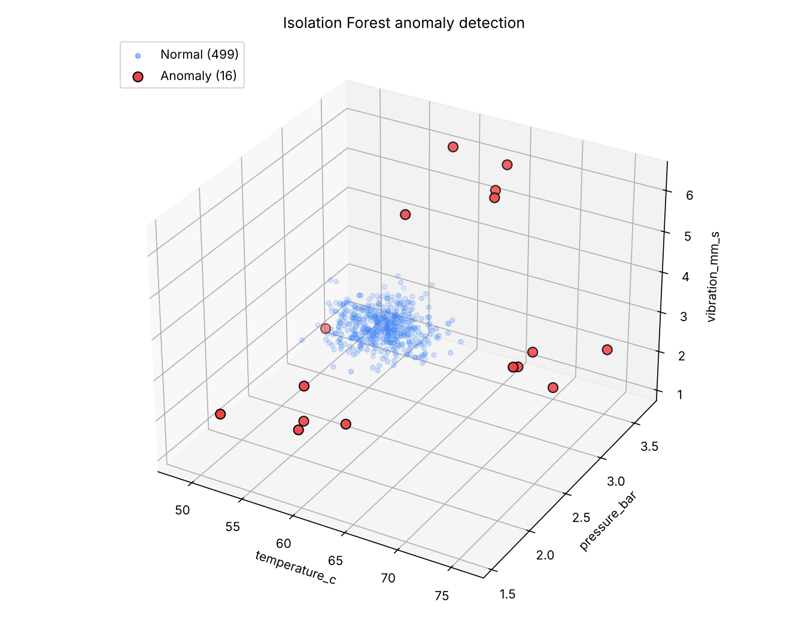

# Python Anomaly Detector



> **Sample project** built for my portfolio. The data is synthetic sensor readings generated by `make_sample_data.py`.
> *Proyecto de muestra. Los datos son lecturas de sensores simuladas. Versión en español más abajo.*

## What it does

A command-line tool that finds unusual rows in any CSV with **Isolation Forest** (scikit-learn). Point it at a file, pick the numeric columns (or let it use all of them), and it delivers:

- `anomalies.csv`: every row with an `anomaly_score` (higher means more unusual) and an `is_anomaly` flag.
- `anomalies.xlsx`: the same data sorted by score, anomalies highlighted in red, with filters, plus a **Summary** sheet comparing normal and anomalous averages.
- `anomalies_3d.png`: 3D scatter of the first three columns, anomalies in red.

Columns are standardized before training, so features with different units (°C, bar, mm/s) weigh the same.

**Result on the demo data:** 515 pump readings (temperature, pressure, vibration) with 15 injected faults. The tool flags **all 15 faults** with 1 false alarm. See [`sample_output/`](sample_output/).

## Run it

```bash
pip install -r requirements.txt
python anomaly_detector.py sample_data/sensor_readings.csv
```

On your own data:

```bash
python anomaly_detector.py transactions.csv --columns amount,hour,items --contamination 0.02 --out results
```

`--contamination` is the expected share of anomalies (default 0.03). `make_sample_data.py` regenerates the demo dataset.

### With Docker

```bash
docker build -t anomaly-detector .
docker run --rm -v "$PWD/output:/app/output" anomaly-detector
```

## Use cases

- Sensor and machine monitoring (overheating, pressure drops, abnormal vibration).
- Suspicious transactions or orders in sales data.
- Data-quality checks before a report: typos, wrong units, outliers.

---

## En español

Herramienta de línea de comandos que encuentra filas inusuales en cualquier CSV con **Isolation Forest**. Entrega un CSV con puntaje y marca de anomalía, un Excel con las anomalías resaltadas y una hoja de resumen, y un gráfico 3D.

En los datos de demo (515 lecturas de una bomba con 15 fallas simuladas) detecta **las 15 fallas** con 1 falsa alarma.

Para correrlo: `pip install -r requirements.txt` y `python anomaly_detector.py sample_data/sensor_readings.csv`. Con Docker: `docker build -t anomaly-detector .` y `docker run --rm -v "$PWD/output:/app/output" anomaly-detector`.

## Contact

Neil Suárez · Python automation, data & AI · Montevideo, Uruguay · English / Español
Available on [Freelancer.com](https://www.freelancer.com/u/neilArqui33).

License: MIT
